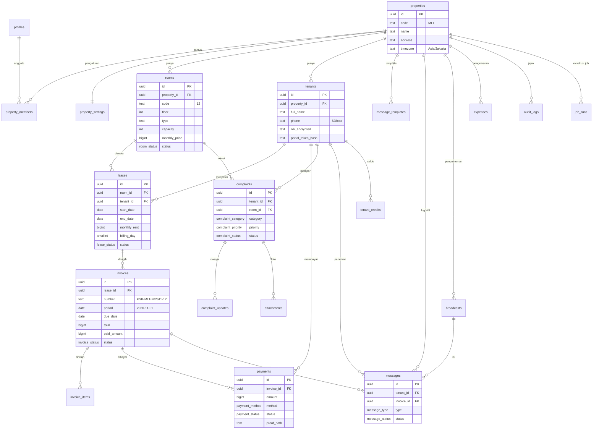

# Desain Database

- **DBMS**: PostgreSQL 15+ (Supabase)
- **Konvensi**: nama tabel & kolom bahasa Inggris, `snake_case`, jamak untuk tabel. Label yang tampil di UI berbahasa Indonesia (lihat tabel *Enum* di bawah).
- **Primary key**: `uuid` (`gen_random_uuid()`), kecuali disebut lain.
- **Uang**: `bigint` dalam Rupiah utuh (Rp1.500.000 → `1500000`). **Jangan pernah** memakai `float`/`numeric` desimal.
- **Waktu**: `timestamptz` (disimpan UTC). Tanggal kalender (jatuh tempo, periode) memakai `date`.
- **Kolom standar** di hampir semua tabel: `created_at timestamptz default now()`, `updated_at timestamptz` (trigger), dan `property_id` untuk keamanan RLS.
- **Hapus data**: *soft delete* (`archived_at`) untuk kamar & penghuni. Tagihan dan pembayaran **tidak pernah dihapus**, hanya dibatalkan.

---

## 1. Diagram relasi (ERD)



---

## 2. Enum

| Enum | Nilai (DB) → Label UI |
|---|---|
| `member_role` | `owner` → Pemilik, `manager` → Pengelola |
| `room_status` | `vacant` → Kosong, `occupied` → Terisi, `reserved` → Dipesan, `maintenance` → Perbaikan |
| `lease_status` | `active` → Aktif, `ended` → Selesai |
| `deposit_status` | `held` → Ditahan, `refunded` → Dikembalikan, `partial_refund` → Dikembalikan sebagian, `forfeited` → Hangus, `transferred` → Dipindah |
| `invoice_status` | `draft` → Draf, `issued` → Belum dibayar, `partial` → Dibayar sebagian, `paid` → Lunas, `void` → Dibatalkan |
| `invoice_item_type` | `rent` → Sewa, `electricity` → Listrik, `water` → Air, `laundry` → Laundry, `late_fee` → Denda, `discount` → Diskon, `other` → Lainnya |
| `payment_method` | `cash` → Tunai, `transfer` → Transfer, `qris` → QRIS, `va` → Virtual Account, `ewallet` → E-wallet, `credit` → Saldo, `other` → Lainnya |
| `payment_status` | `pending` → Menunggu verifikasi, `verified` → Terverifikasi, `rejected` → Ditolak |
| `complaint_category` | `electricity`, `water`, `ac`, `internet`, `cleanliness`, `security`, `facility`, `neighbor`, `other` |
| `complaint_priority` | `low` → Rendah, `medium` → Sedang, `high` → Tinggi, `urgent` → Darurat |
| `complaint_status` | `open` → Baru, `in_progress` → Diproses, `resolved` → Selesai, `rejected` → Ditolak |
| `message_type` | `reminder_before`, `reminder_due`, `reminder_overdue_1`, `reminder_overdue_3`, `reminder_overdue_7`, `payment_confirmed`, `payment_rejected`, `welcome`, `complaint_new_owner`, `complaint_update`, `proof_uploaded_owner`, `broadcast`, `manual` |
| `message_status` | `queued` → Antri, `sending` → Mengirim, `sent` → Terkirim, `delivered` → Diterima, `read` → Dibaca, `failed` → Gagal, `skipped` → Dilewati |

> Status **Terlambat** tidak disimpan. Ia dihitung: `status IN ('issued','partial') AND due_date < today(property tz)`.

---

## 3. Definisi tabel

### 3.1 Pengguna & properti

**`profiles`**: data tambahan untuk `auth.users` (Supabase Auth)
| Kolom | Tipe | Keterangan |
|---|---|---|
| id | uuid PK | = `auth.users.id` |
| full_name | text not null | |
| phone | text | untuk notifikasi WA ke pemilik/pengelola |
| created_at | timestamptz | |

**`properties`**
| Kolom | Tipe | Keterangan |
|---|---|---|
| id | uuid PK | |
| code | text not null unique | 2–5 huruf, dipakai di nomor tagihan, mis. `MLT` |
| name | text not null | "Kos Melati" |
| address | text | |
| timezone | text not null default `'Asia/Jakarta'` | |
| contact_phone | text | no. WA pengelola yang tampil ke penghuni |
| rules | text | aturan kos (markdown), tampil di portal |
| archived_at | timestamptz | |

**`property_members`**
| Kolom | Tipe | Keterangan |
|---|---|---|
| property_id | uuid FK → properties | PK gabungan |
| user_id | uuid FK → profiles | PK gabungan |
| role | member_role not null | |
| can_view_finance | boolean default false | izin laporan keuangan untuk manager |

**`property_settings`** (1:1 dengan properties)
| Kolom | Tipe | Default | Keterangan |
|---|---|---|---|
| property_id | uuid PK FK | | |
| invoice_lead_days | smallint | 7 | tagihan dibuat N hari sebelum jatuh tempo |
| reminder_offsets | smallint[] | `{-3,0,1,3,7}` | hari relatif terhadap jatuh tempo |
| reminders_enabled | boolean | true | |
| quiet_start / quiet_end | time | 20:00 / 08:00 | jam tidak boleh kirim WA |
| late_fee_type | text | `'none'` | `none` / `fixed` / `daily` |
| late_fee_amount | bigint | 0 | |
| late_fee_max | bigint | null | batas denda harian |
| late_fee_grace_days | smallint | 3 | |
| bank_accounts | jsonb | `[]` | `[{bank:"BCA", number:"123", holder:"Budi"}]` |
| wa_provider | text | `'fonnte'` | |
| prorate_first_month | boolean | true | |

### 3.2 Kamar, penghuni, sewa

**`rooms`**
| Kolom | Tipe | Keterangan |
|---|---|---|
| id | uuid PK | |
| property_id | uuid FK not null | |
| code | text not null | "12", "A-03"; `UNIQUE(property_id, code)` |
| floor | smallint | |
| type | text | "Standar", "AC + KM dalam" |
| capacity | smallint default 1 | > 1 untuk kamar sharing |
| monthly_price | bigint not null | harga default |
| deposit_amount | bigint default 0 | |
| facilities | text[] | `{AC, WiFi, KM dalam, Lemari}` |
| status | room_status default `vacant` | `occupied` disinkronkan dari sewa aktif |
| notes | text | |
| archived_at | timestamptz | |

**`tenants`**
| Kolom | Tipe | Keterangan |
|---|---|---|
| id | uuid PK | |
| property_id | uuid FK not null | |
| full_name | text not null | |
| phone | text not null | E.164 tanpa `+`: `6281234567890` |
| email | text | |
| nik_encrypted | text | NIK terenkripsi (pgsodium / app-level AES-GCM) |
| nik_last4 | text | untuk tampilan tersamar |
| id_card_path | text | path di bucket privat `id-cards` |
| occupation | text | pekerjaan / kampus |
| emergency_name / emergency_relation / emergency_phone | text | |
| reminders_muted | boolean default false | FR-5.10 |
| portal_token_hash | text unique | SHA-256 dari token |
| portal_token_created_at | timestamptz | |
| notes | text | |
| archived_at | timestamptz | |

**`leases`** (kontrak sewa)
| Kolom | Tipe | Keterangan |
|---|---|---|
| id | uuid PK | |
| property_id | uuid FK not null | |
| room_id | uuid FK not null | |
| tenant_id | uuid FK not null | |
| start_date | date not null | |
| end_date | date | null = belum keluar / tanpa batas |
| monthly_rent | bigint not null | harga yang disepakati |
| billing_day | smallint not null | `CHECK (billing_day BETWEEN 1 AND 28)` |
| deposit_amount | bigint default 0 | |
| deposit_status | deposit_status default `held` | |
| deposit_refunded | bigint default 0 | |
| status | lease_status default `active` | |
| ended_reason | text | |

Constraint penting:
```sql
-- satu sewa aktif per kamar (untuk kamar kapasitas 1; kamar sharing dicek di aplikasi)
CREATE UNIQUE INDEX one_active_lease_per_room
  ON leases(room_id) WHERE status = 'active';
```

### 3.3 Tagihan & pembayaran

**`invoices`**
| Kolom | Tipe | Keterangan |
|---|---|---|
| id | uuid PK | |
| property_id | uuid FK not null | |
| lease_id | uuid FK not null | |
| tenant_id | uuid FK not null | denormalisasi untuk query cepat |
| room_id | uuid FK not null | denormalisasi |
| number | text not null unique | `KSK-MLT-202611-12` |
| period | date not null | selalu tanggal 1, mis. `2026-11-01` |
| issue_date | date not null | |
| due_date | date not null | |
| total | bigint not null default 0 | = SUM(invoice_items.amount), dijaga trigger |
| paid_amount | bigint not null default 0 | = SUM(payments verified), dijaga trigger |
| status | invoice_status not null default `issued` | |
| paid_at | timestamptz | |
| void_reason | text | |
| payment_link | text | fase 3 (gateway) |

```sql
UNIQUE (lease_id, period)          -- anti tagihan ganda (FR-3.2)
CHECK (paid_amount >= 0)
INDEX (property_id, period)
INDEX (property_id, status, due_date)
```

**`invoice_items`**
| Kolom | Tipe | Keterangan |
|---|---|---|
| id | uuid PK | |
| invoice_id | uuid FK not null | |
| type | invoice_item_type not null | |
| description | text not null | "Sewa November 2026", "Denda 5 hari" |
| amount | bigint not null | negatif untuk diskon |
| meta | jsonb | mis. `{kwh_start, kwh_end}` atau `{days_late}` |

**`payments`**
| Kolom | Tipe | Keterangan |
|---|---|---|
| id | uuid PK | |
| property_id | uuid FK not null | |
| invoice_id | uuid FK not null | |
| tenant_id | uuid FK not null | |
| amount | bigint not null | `CHECK (amount > 0)` |
| paid_at | timestamptz not null | waktu bayar menurut penghuni/pencatat |
| method | payment_method not null | |
| status | payment_status not null | |
| proof_path | text | bucket privat `payment-proofs` |
| submitted_by | text | `tenant` / `staff` / `gateway` |
| recorded_by | uuid FK → profiles | null jika dari penghuni/gateway |
| verified_by | uuid FK → profiles | |
| verified_at | timestamptz | |
| rejection_reason | text | |
| gateway_ref | text unique | ID transaksi gateway (idempoten webhook) |
| notes | text | |

**`tenant_credits`** (saldo kelebihan bayar, FR-4.5)
| Kolom | Tipe | Keterangan |
|---|---|---|
| id | uuid PK | |
| tenant_id | uuid FK | |
| amount | bigint | + masuk (kelebihan), − dipakai |
| source_payment_id / applied_invoice_id | uuid | |
| created_at | timestamptz | |

Saldo = `SUM(amount)` per penghuni.

### 3.4 Komplain

**`complaints`**
| Kolom | Tipe | Keterangan |
|---|---|---|
| id | uuid PK | |
| property_id | uuid FK not null | |
| number | serial per properti | tampil "#24" |
| tenant_id | uuid FK | null jika dilaporkan staf untuk area umum |
| room_id | uuid FK | null = area umum (dapur, parkir) |
| location | text | "Dapur lantai 2" bila bukan kamar |
| category | complaint_category not null | |
| title | text not null | |
| description | text | |
| priority | complaint_priority default `medium` | |
| status | complaint_status default `open` | |
| assignee_name / assignee_phone | text | teknisi |
| cost | bigint | biaya perbaikan → buat `expenses` |
| rating | smallint | 1–5 |
| resolved_at | timestamptz | |
| created_at | timestamptz | |

**`complaint_updates`**: riwayat status & komentar
| Kolom | Tipe | Keterangan |
|---|---|---|
| id | uuid PK | |
| complaint_id | uuid FK | |
| author_type | text | `tenant` / `staff` / `system` |
| author_user_id | uuid | jika staf |
| from_status / to_status | complaint_status | null jika hanya komentar |
| body | text | |
| created_at | timestamptz | |

**`attachments`**: foto (dipakai komplain, bisa dipakai entitas lain)
| Kolom | Tipe | Keterangan |
|---|---|---|
| id | uuid PK | |
| property_id | uuid FK | |
| entity_type | text | `complaint`, `complaint_update`, `expense`, `room` |
| entity_id | uuid | |
| path | text | path storage |
| mime_type / size_bytes | text / int | maks 5 MB, gambar dikompres di client |

### 3.5 WhatsApp

**`message_templates`**
| Kolom | Tipe | Keterangan |
|---|---|---|
| id | uuid PK | |
| property_id | uuid FK | |
| type | message_type | `UNIQUE(property_id, type)` |
| body | text | berisi variabel `{nama}`, `{nominal}`, ... |
| enabled | boolean default true | |

**`messages`**: log & antrian pengiriman
| Kolom | Tipe | Keterangan |
|---|---|---|
| id | uuid PK | |
| property_id | uuid FK | |
| tenant_id | uuid FK | null jika ke pemilik |
| to_phone | text not null | |
| type | message_type not null | |
| invoice_id | uuid FK | untuk pengingat |
| complaint_id | uuid FK | |
| broadcast_id | uuid FK | |
| body | text not null | hasil render template |
| status | message_status default `queued` | |
| scheduled_at | timestamptz not null | menghormati jam tenang |
| attempts | smallint default 0 | |
| provider_message_id | text | |
| error | text | |
| sent_at | timestamptz | |

```sql
-- satu jenis pengingat hanya sekali per tagihan (FR-5.3)
CREATE UNIQUE INDEX one_reminder_per_type
  ON messages(invoice_id, type) WHERE invoice_id IS NOT NULL;
INDEX (status, scheduled_at)   -- worker mengambil antrian
```

**`broadcasts`**
| Kolom | Tipe | Keterangan |
|---|---|---|
| id | uuid PK | |
| property_id | uuid FK | |
| title | text | |
| body | text | |
| audience | jsonb | `{all:true}` / `{floors:[2]}` / `{tenant_ids:[...]}` |
| created_by | uuid FK | |
| created_at | timestamptz | |

### 3.6 Keuangan & sistem

**`expenses`**
| Kolom | Tipe | Keterangan |
|---|---|---|
| id | uuid PK | |
| property_id | uuid FK | |
| category | text | `electricity`, `water`, `internet`, `cleaning`, `repair`, `salary`, `tax`, `other` |
| amount | bigint not null | |
| spent_on | date not null | |
| description | text | |
| complaint_id | uuid FK | jika dari perbaikan |
| receipt_path | text | |
| created_by | uuid FK | |

**`audit_logs`**
| Kolom | Tipe | Keterangan |
|---|---|---|
| id | bigint identity PK | |
| property_id | uuid | |
| actor_type | text | `user` / `tenant` / `system` / `gateway` |
| actor_id | uuid | |
| action | text | `invoice.void`, `payment.verify`, `lease.end`, ... |
| entity_type / entity_id | text / uuid | |
| before / after | jsonb | |
| created_at | timestamptz | |

**`job_runs`**
| Kolom | Tipe | Keterangan |
|---|---|---|
| id | bigint identity PK | |
| job | text | `generate_invoices`, `apply_late_fees`, `schedule_reminders`, `send_messages` |
| property_id | uuid | null = semua |
| started_at / finished_at | timestamptz | |
| status | text | `running` / `success` / `failed` |
| processed | int | |
| error | text | |

---

## 4. Logika penting di database

### 4.1 Hitung ulang status tagihan
Trigger setelah `INSERT/UPDATE` pada `payments` dan `invoice_items`:
```sql
paid_amount := COALESCE(SUM(amount) FILTER (WHERE status='verified'), 0)
total       := SUM(invoice_items.amount)
status      := CASE
                 WHEN status = 'void'          THEN 'void'
                 WHEN paid_amount >= total     THEN 'paid'
                 WHEN paid_amount > 0          THEN 'partial'
                 ELSE 'issued'
               END
paid_at     := CASE WHEN status='paid' THEN COALESCE(paid_at, now()) END
```
Kelebihan (`paid_amount - total > 0`) dicatat ke `tenant_credits` oleh aplikasi dalam transaksi yang sama.

### 4.2 Perhitungan jatuh tempo
```
due_date(period, billing_day) = make_date(year(period), month(period), billing_day)
```
`billing_day` dibatasi 1–28 sehingga selalu valid di setiap bulan.

### 4.3 Row Level Security (contoh)
```sql
ALTER TABLE rooms ENABLE ROW LEVEL SECURITY;

CREATE POLICY "anggota properti bisa baca kamar" ON rooms
  FOR SELECT USING (
    property_id IN (SELECT property_id FROM property_members WHERE user_id = auth.uid())
  );
```
Pola yang sama diterapkan ke semua tabel ber-`property_id`. Tabel keuangan (`expenses`, laporan) ditambah syarat `role = 'owner' OR can_view_finance`.

Portal penghuni **tidak** memakai RLS berbasis `auth.uid()`. Server memvalidasi token, lalu melakukan query dengan filter `tenant_id` secara eksplisit di server (service role, tidak pernah di browser).

### 4.4 Storage bucket
| Bucket | Akses | Isi |
|---|---|---|
| `id-cards` | privat | foto KTP |
| `payment-proofs` | privat | bukti transfer |
| `complaint-photos` | privat | foto komplain |
| `receipts` | privat | nota pengeluaran |
| `room-photos` | publik | foto kamar (untuk promosi) |

---

## 5. Data contoh (seed) untuk development
- 1 properti "Kos Melati" (`MLT`), 12 kamar (3 lantai × 4), 9 terisi.
- 9 penghuni dengan tanggal tagih bervariasi (1, 5, 10, 15, 25).
- Tagihan 3 bulan terakhir dengan campuran lunas, sebagian, dan terlambat.
- 5 komplain dengan status berbeda.
