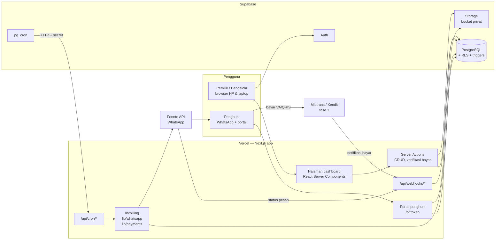
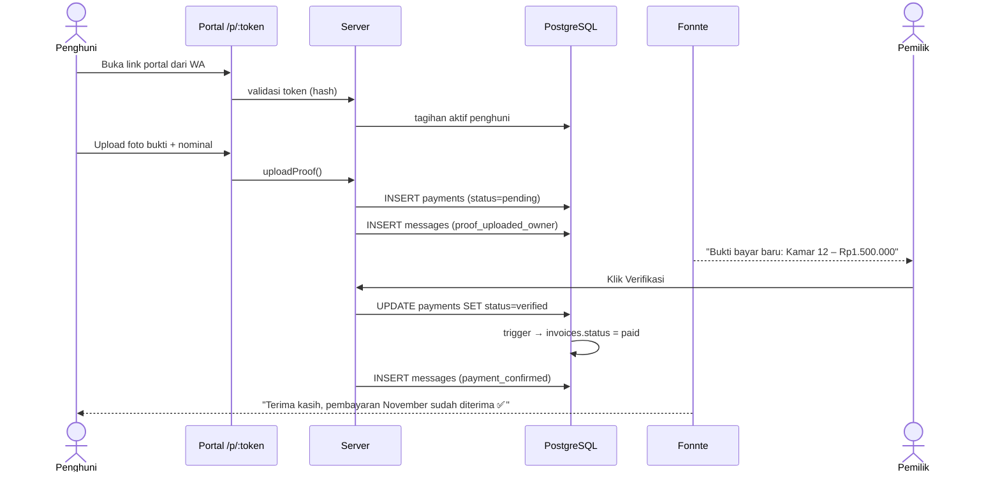
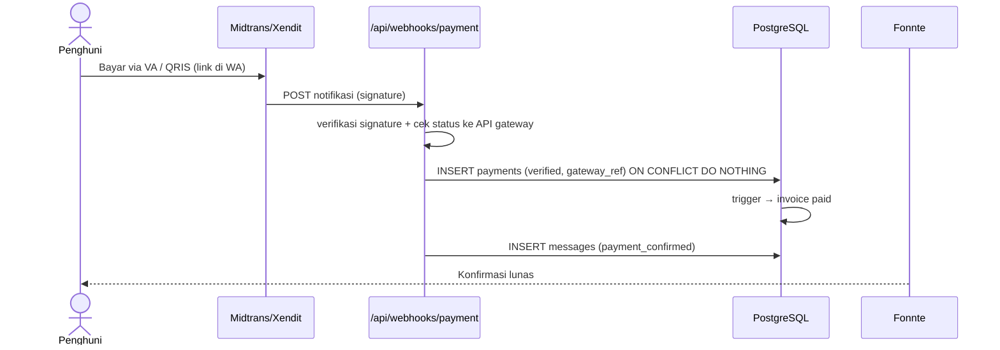
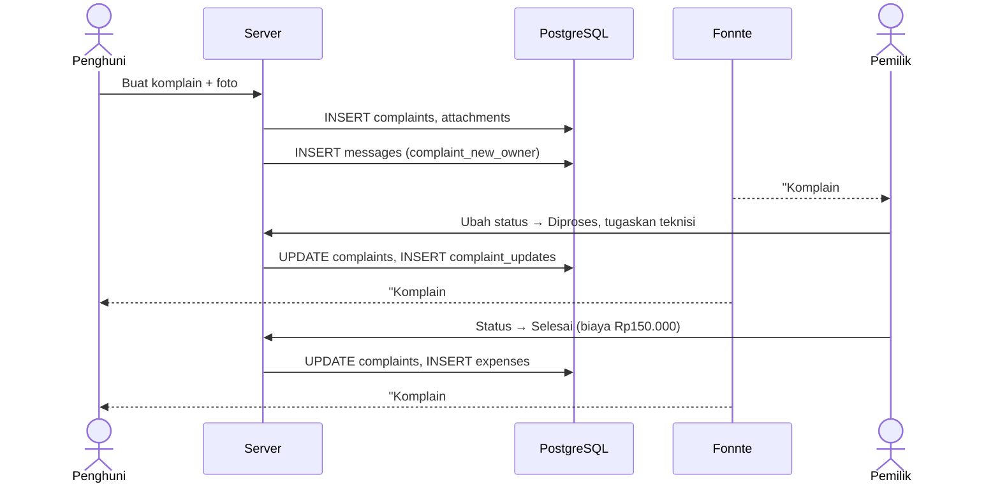

# Arsitektur Sistem

## 1. Gambaran umum



**Prinsip:**
1. **Logika bisnis murni** (hitung tagihan, denda, status, jadwal pengingat, render template) ada di `src/lib/billing` dan `src/lib/messaging` sebagai fungsi tanpa efek samping, sehingga mudah di-unit-test.
2. **Database sebagai penjaga terakhir**: constraint `UNIQUE`, `CHECK`, dan trigger memastikan data tetap benar walaupun ada bug di aplikasi.
3. **Semua job idempoten**: aman dijalankan ulang kapan saja.
4. **Provider eksternal di balik interface** (`WhatsAppProvider`, `PaymentGateway`) supaya mudah diganti dan di-mock saat test.

---

## 2. Job terjadwal

**Vercel Cron** (`vercel.json`) memanggil endpoint Next.js dengan header `Authorization: Bearer <CRON_SECRET>` (dikirim otomatis oleh Vercel bila env `CRON_SECRET` diisi). Vercel Hobby hanya mengizinkan cron harian; untuk job yang lebih sering (`send_messages` tiap 5 menit di Fase 2) pakai `pg_cron` Supabase atau Vercel Pro.

> **Status Fase 2:** `generate_invoices`, `apply_late_fees`, dan `schedule_reminders` dijalankan berurutan oleh `/api/cron/daily` (07.00 WIB). `send_messages` = `/api/cron/send-messages` (Vercel harian 08.05 WIB + disarankan pg_cron tiap 5 menit, lihat README). Jeda antar pesan 2–4 detik (bukan 5–15) agar muat di batas 60 detik fungsi serverless; Fonnte mengantrikan pengiriman di sisi mereka. Logika: `src/services/jobs.ts`, `messaging.ts`, `billing.ts`.

| Job | Jadwal (WIB) | Endpoint | Tugas |
|---|---|---|---|
| `generate_invoices` | 07.00, langkah 1 | `GET/POST /api/cron/daily` | Buat tagihan untuk sewa aktif yang jatuh tempo ≤ `invoice_lead_days` hari lagi dan belum punya tagihan periode itu |
| `apply_late_fees` | 07.00, langkah 2 | (sama) | Tambah/perbarui item `late_fee` otomatis untuk tagihan terlambat melewati masa tenggang |
| `schedule_reminders` | 07.00, langkah 3 | (sama) | Masukkan pengingat ke antrian `messages` (`scheduled_at` ≥ akhir jam tenang) |
| `send_messages` | 08.05 (Vercel) + tiap 5 menit (pg_cron, opsional) | `GET/POST /api/cron/send-messages` | Ambil ≤ 20 pesan `queued` yang sudah waktunya, kirim dengan jeda 2–4 detik, perbarui status / retry |

Setiap eksekusi mencatat baris di `job_runs`. Dashboard menampilkan peringatan bila job terakhir `failed` atau tidak berjalan > 26 jam.

> **Catatan Vercel**: fungsi serverless di tier Hobby dibatasi ±60 detik. Karena itu `send_messages` hanya memproses batch kecil per pemanggilan dan dipanggil tiap 5 menit, bukan mengirim semua sekaligus.

### 2.1 Pembuatan tagihan
Rencana tagihan dihitung oleh fungsi murni `planInvoices` (`src/lib/billing/plan.ts`) dengan **model siklus**: tagihan periode P menutup `[tanggal tagih P, tanggal tagih P+1)`. Penghuni yang masuk di tengah siklus mendapat tagihan pertama yang jatuh tempo di hari masuk (prorata bila diaktifkan). `generateInvoicesForLease` (`src/services/billing.ts`) lalu menyisipkan tagihan + item sewa dengan `onConflictDoNothing` pada `UNIQUE(lease_id, period)` (idempoten) dan langsung memotong saldo kredit bila ada.

### 2.2 Pseudocode `schedule_reminders`
```ts
for (const inv of openInvoices) {                  // status issued | partial
  if (inv.tenant.remindersMuted) continue
  const offset = daysBetween(inv.dueDate, today)   // -3, 0, 1, 3, 7
  const type   = reminderTypeFor(offset, settings.reminderOffsets)
  if (!type) continue
  await db.insert(messages)
    .values({ invoiceId: inv.id, type, body: render(template, vars), scheduledAt: nextAllowedTime(now, quietHours) })
    .onConflictDoNothing()                         // UNIQUE(invoice_id, type)
}
```

---

## 3. Alur utama (sequence diagram)

### 3.1 Penghuni upload bukti → verifikasi → lunas



### 3.2 Pembayaran via payment gateway (fase 3)



### 3.3 Komplain



---

## 4. Integrasi WhatsApp

### 4.1 Interface
```ts
interface WhatsAppProvider {
  send(input: { to: string; body: string; mediaUrl?: string }): Promise<
    { ok: true; providerMessageId: string } | { ok: false; error: string; retryable: boolean }
  >
}
```
Implementasi: `FonnteProvider` (default), `CloudApiProvider` (opsional), `ConsoleProvider` (development, hanya mencetak ke log).

### 4.2 Fonnte
- Endpoint: `POST https://api.fonnte.com/send`, header `Authorization: <FONNTE_TOKEN>`, body `target`, `message`.
- Webhook status (opsional): `POST /api/webhooks/fonnte` → update `messages.status` menjadi `delivered`/`read`.

### 4.3 Aturan anti-blokir
- Gunakan **nomor WA khusus kos**, bukan nomor pribadi. Sebaiknya nomor yang sudah aktif lama.
- Jeda acak 5–15 detik antar pesan, maksimum ±200 pesan/hari.
- Pesan dipersonalisasi (nama, kamar, nominal) sehingga tidak identik.
- Minta penghuni menyimpan nomor kos saat check-in (pesan sambutan).
- Tidak kirim di luar jam 08.00–20.00.

### Template pesan WA default

**Pengingat H-3** (`reminder_before`)
```
Halo {nama} 👋
Pengingat dari {nama_kos}: sewa kamar {kamar} periode {periode} sebesar *{nominal}* jatuh tempo *{jatuh_tempo}*.

Transfer ke:
{rekening}

Setelah transfer, upload bukti di sini ya:
{link_portal}

Terima kasih 🙏
```

**Jatuh tempo hari ini** (`reminder_due`)
```
Halo {nama}, hari ini ({jatuh_tempo}) jatuh tempo sewa kamar {kamar} sebesar *{sisa}*.
Bayar & upload bukti: {link_portal}
Abaikan pesan ini jika sudah membayar. Terima kasih 🙏
```

**Terlambat** (`reminder_overdue_*`)
```
Halo {nama}, sewa kamar {kamar} periode {periode} sudah lewat jatuh tempo {hari_telat} hari.
Sisa tagihan: *{sisa}*{denda_info}
Mohon segera diselesaikan: {link_portal}
Jika ada kendala, silakan balas pesan ini 🙏
```

**Konfirmasi lunas** (`payment_confirmed`)
```
Terima kasih {nama} ✅
Pembayaran {periode} kamar {kamar} sebesar {nominal} sudah kami terima.
Kuitansi: {link_kuitansi}
```

**Pembayaran ditolak** (`payment_rejected`)
```
Halo {nama}, bukti pembayaran yang kamu kirim belum dapat kami verifikasi.
Alasan: {alasan}
Silakan upload ulang: {link_portal}
```

**Sambutan check-in** (`welcome`)
```
Selamat datang di {nama_kos}, {nama}! 🏠
Kamar: {kamar} | Sewa: {nominal}/bulan | Tagih setiap tgl {tgl_tagih}

Simpan nomor ini ya, semua info tagihan & pengumuman akan dikirim dari sini.
Portal penghuni (tagihan, bayar, lapor kerusakan): {link_portal}
```

---

## 5. Endpoint & server actions

### 5.1 Route handler (HTTP)
| Method | Path | Auth | Fungsi |
|---|---|---|---|
| GET/POST | `/api/cron/daily` | `CRON_SECRET` | Tagihan → denda → jadwal pengingat |
| GET/POST | `/api/cron/send-messages` | `CRON_SECRET` | Worker kirim WA |
| POST | `/api/webhooks/fonnte?secret=…` | `FONNTE_WEBHOOK_SECRET` | Status pesan (terkirim/dibaca) |
| POST | `/api/webhooks/payment` | signature Midtrans + cek status ke API | Notifikasi bayar |
| GET | `/api/reports/[monthly\|yearly\|aging]?format=xlsx\|pdf` | sesi + izin keuangan | Ekspor laporan |
| GET | `/api/invoices/[id]/pdf` | sesi (RLS) | PDF tagihan / kuitansi staf |
| GET | `/p/[token]/tagihan/[id]/pdf` | token portal | PDF untuk penghuni |
| GET | `/api/files/[bucket]/[...path]?exp&sig` | URL bertanda tangan HMAC | File lokal (development saja) |

### 5.2 Server actions (dipanggil dari form UI)
| Modul | Actions |
|---|---|
| Properti | `createProperty`, `updateProperty`, `updateSettings` |
| Kamar | `createRoom`, `updateRoom`, `archiveRoom` |
| Penghuni | `createTenant`, `updateTenant`, `regeneratePortalToken`, `muteReminders` |
| Sewa | `checkIn`, `checkOut`, `moveRoom` |
| Tagihan | `addInvoiceItem`, `adjustInvoice`, `voidInvoice`, `generateInvoiceNow` |
| Pembayaran | `recordPayment`, `verifyPayment`, `rejectPayment` |
| Pesan | `sendReminderNow`, `resendMessage`, `updateTemplate`, `createBroadcast` |
| Komplain | `createComplaint`, `updateComplaintStatus`, `addComplaintComment`, `assignComplaint` |
| Pengeluaran | `createExpense`, `updateExpense`, `deleteExpense` |
| Tim | `inviteMember`, `removeMember`, `updateMemberRole` |
| Portal | `portalUploadProof`, `portalCreateComplaint`, `portalComment`, `portalRateComplaint` |

Setiap action: validasi input dengan Zod → cek peran user → jalankan dalam transaksi → tulis `audit_logs` → `revalidatePath`.

---

## 6. Keamanan

| Ancaman | Kontrol |
|---|---|
| User melihat data kos orang lain | RLS per `property_id` + cek peran di setiap server action |
| Token portal bocor | Token 256-bit acak, disimpan sebagai hash, dapat dicabut, rate-limit akses, kedaluwarsa setelah check-out |
| Endpoint cron dipanggil orang luar | Wajib header `CRON_SECRET`, dibandingkan dengan perbandingan waktu-konstan |
| Webhook palsu "sudah bayar" | Verifikasi signature + konfirmasi ulang status ke API gateway + `gateway_ref` unik |
| Upload file berbahaya | Batasi tipe (jpg/png/webp/pdf) dan ukuran (5 MB), kompres di client, simpan di bucket privat |
| Kebocoran rahasia | `.env` di `.gitignore`, rahasia hanya di Vercel/Supabase env, `SUPABASE_SERVICE_ROLE_KEY` hanya dipakai di server |
| Manipulasi nominal | Nominal tagihan dihitung server, tidak pernah dari input browser penghuni |

### Environment variables
```
NEXT_PUBLIC_SUPABASE_URL=
NEXT_PUBLIC_SUPABASE_ANON_KEY=
SUPABASE_SERVICE_ROLE_KEY=      # server only
DATABASE_URL=                   # Drizzle migrations
CRON_SECRET=
PORTAL_BASE_URL=https://kosku.example.com
FONNTE_TOKEN=
FONNTE_WEBHOOK_SECRET=
NIK_ENCRYPTION_KEY=             # 32 byte base64
SENTRY_DSN=
# fase 3
MIDTRANS_SERVER_KEY=
MIDTRANS_IS_PRODUCTION=false
```

---

## 7. Lingkungan (environments)

| Env | Database | WA provider | Deploy |
|---|---|---|---|
| Local | Supabase CLI (Docker) | `ConsoleProvider` | `pnpm dev` |
| Preview | Supabase project "staging" | Fonnte ke nomor penguji saja | otomatis tiap PR (Vercel) |
| Production | Supabase project "prod" | Fonnte | merge ke `main` |
